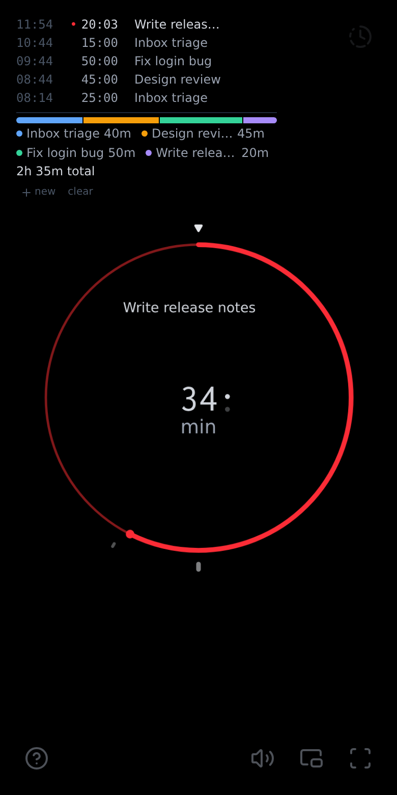

# 🌀 Coil

A minimal visual timer with a built-in time log.

**[Open Coil](https://ajweeks.com/coil-timer/)**

_Forked from [z0u/coil-timer](https://github.com/z0u/coil-timer)_

<p>
  
</p>

## Controls

| Action               | Mouse / touch                  | Keyboard                |
| -------------------- | ------------------------------ | ----------------------- |
| Start / pause        | Click the clock                | Space / Enter           |
| Set time             | Drag around the clock / scroll | Arrows (Shift = bigger) |
| Show end time        | Hold the clock                 |                         |
| New log block        | `+ new` in the log             | N                       |
| Undo log change      | `undo`                         | Ctrl+Z                  |
| Show / hide controls | Click the background           |                         |
| Fullscreen           | Double-click the background    |                         |

## Development

```sh
npm install
npm run dev
npm run png    # regenerate PNG icons from the SVGs (needs rsvg-convert)
npm run build
```

### Desktop app (Windows / Linux)

The same code also builds as a [Tauri](https://tauri.app) desktop app, with a frameless, optionally
see-through and always-on-top window. Needs [Rust](https://rustup.rs) and the
[Tauri prerequisites](https://tauri.app/start/prerequisites/) for your OS.

```sh
npm run desktop        # run the desktop app with hot reload
npm run build:desktop  # installers → src-tauri/target/release/bundle/
npm run build:all      # web (dist/) and desktop
npm run icons:desktop  # regenerate the app icons from public/icon-desktop.svg
```

CI builds both on every push and PR (desktop installers are attached to the run as artifacts), and
deploys the web app from `main`. `npm run release` bumps the patch version and pushes a tag, which
publishes a draft GitHub release with the installers.
