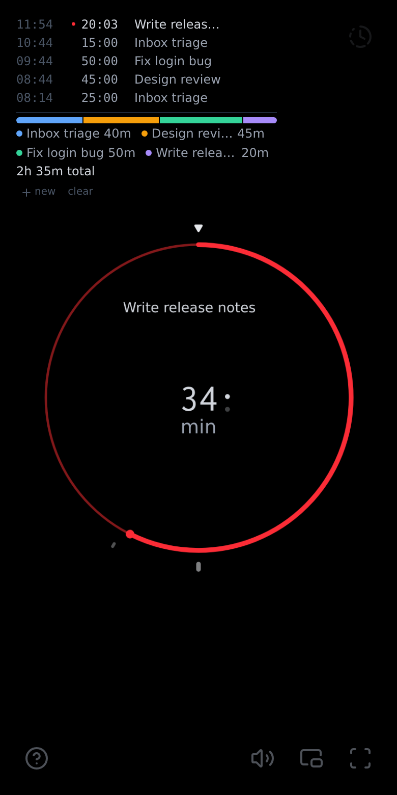

# 🌀 Coil

A minimal visual timer with a built-in time log.

**[Open Coil](https://ajweeks.com/coil-timer/)**

*Forked from [z0u/coil-timer](https://github.com/z0u/coil-timer)*

<p>
  
</p>

## Controls

| Action               | Mouse / touch                 | Keyboard                |
| -------------------- | ----------------------------- | ----------------------- |
| Start / pause        | Click the clock               | Space / Enter           |
| Set time             | Drag around the clock, scroll | Arrows (Shift = bigger) |
| Show end time        | Hold the clock                |                         |
| New log block        | `+ new` in the log            | N                       |
| Undo log change      | `undo`                        | Ctrl+Z                  |
| Show / hide controls | Click the background          |                         |
| Fullscreen           | Double-click the background   |                         |

## Development

```sh
npm install
npm run dev      # http://localhost:5273
npm run png      # regenerate PNG icons from the SVGs (needs rsvg-convert)
npm run build    # production build in dist/
```
